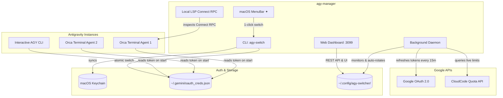

# Antigravity Multi-License Orchestrator ✦

[](LICENSE)
[](https://www.python.org/downloads/)
[]()
[]()

Production-grade multi-account license manager, live telemetry hub, and automated quota orchestrator for **Google Antigravity (AGY)**.

Seamlessly pool, monitor, and auto-rotate between multiple **Google AI Pro** licenses in real-time — ensuring your AI agents, coding sessions, Orca terminals, and developer tools never get blocked when hitting 5-hour rolling limits or 7-day quota caps.

---

## 🚀 Key Features

* **🔄 Zero-Downtime Auto-Rotation:** Proactively detects quota exhaustion (5-hour burst limits or 7-day individual caps) and auto-rotates active credentials to the best available Google AI Pro account.
* **🌐 Modern Dark-Mode Web Dashboard (`:3099`):** Real-time monitoring hub with visual quota meters, live reset countdowns, token usage charts, 1-click profile switching, and web-based Google OAuth login.
* **⚡ Native macOS MenuBar App (`✦ AGY`):** Lightweight status bar widget displaying active license health and enabling instant 1-click account switching with hotkeys.
* **🧠 Deep Connect RPC Inspection:** Scans running Antigravity Language Server instances (`/exa.language_server_pb.LanguageServerService`) to inspect real-time token decrements and precise reset timestamps.
* **🔒 Zero Logouts & Atomic Token Refresh:** Background daemon keeps all registered accounts active and refreshed via Google OAuth APIs, syncing tokens directly to macOS Keychain and `~/.gemini/oauth_creds.json`.
* **🛡️ Smart Scoring & Safe Tier Segregation:** Automatically prioritizes Pro subscriptions in rotation pools while preserving Starter/Free accounts for manual testing.

---

## 🏗️ Architecture & Data Flow



---

## 📦 Quickstart & Installation

### One-line installer (macOS & Linux)

```bash
git clone https://github.com/mkmlabs-ai/antigravity-license-manager.git ~/.local/share/agy-manager
cd ~/.local/share/agy-manager
bash install.sh
```

### What the installer does:
1. Installs CLI launchers (`agy-switch`, `agy-hub`) into `~/.local/bin/`.
2. Compiles the native macOS MenuBar app using `swiftc`.
3. Sets up background services via macOS `launchd` (`com.mkm.agy-license-daemon` & `com.mkm.agy-web-dashboard`).
4. Auto-discovers and imports all existing Antigravity logins from Keychain and legacy config.

---

## 💻 CLI Usage (`agy-switch`)

The `agy-switch` utility gives you complete control over your accounts directly from your terminal:

```bash
# 1. Interactive selection menu (with live quotas & health status)
agy-switch

# 2. Auto-select and switch to the best Pro account
agy-switch auto
# or
agy-switch best

# 3. Switch directly to a specific account by ID or email
agy-switch rodziewiczmic
agy-switch myaccount@gmail.com

# 4. List all registered accounts with tier, remaining quotas, and reset times
agy-switch list

# 5. Connect a new Google account via browser OAuth
agy-switch add

# 6. Force immediate token refresh and live quota sync from Google
agy-switch refresh

# 7. Export all licenses to a portable bundle file (for sharing across machines/teammates)
agy-switch export licenses.bundle

# 8. Import all licenses from a bundle file (1-click access, zero browser logins needed)
agy-switch import licenses.bundle

# 9. Remove an account from the pool
agy-switch remove myaccount@gmail.com

# 10. Launch Web Dashboard
agy-hub
```

---

## 🌐 Web Dashboard (`http://127.0.0.1:3099`)

Run `agy-hub` or open `http://127.0.0.1:3099` in your browser.

### Features:
* **Live Quota Gauges:** Real-time visual progress bars for Gemini 5-hour rolling limits and 7-day subscription caps.
* **Instant 1-Click Switching:** Click on any license card to switch system-wide credentials atomically across macOS Keychain and `~/.gemini/`.
* **One-Click Google Login:** Authorize new Google AI Pro or Starter accounts directly from the browser.
* **Token Analytics & Telemetry:** Historical SQLite token consumption breakdown (Prompt, Completion, Thinking, Cache).
* **REST API:**
  * `GET /api/profiles` — Fetch all profiles, current active license, and recommended candidate.
  * `POST /api/switch` — Switch active profile `{ "profile_id": "..." }`.
  * `POST /api/refresh` — Trigger global token refresh and quota query.
  * `POST /api/login/start` — Initiate OAuth login flow.
  * `POST /api/delete` — Delete account profile.

---

## ⚡ Native macOS MenuBar App (`✦ AGY`)

The project includes a lightweight native status bar item written in Swift:

* **Instant Visual Status:** Shows `✦ AGY` in the top macOS menu bar.
* **Dynamic Menu:** Lists all connected accounts labeled with `[Pro]` or `[Starter]`, highlighting the currently active account with a checkmark (`✓`).
* **Keyboard Shortcuts:**
  * `r` — Force refresh live quotas from Google.
  * `o` — Open Web Dashboard in browser (`:3099`).
  * `n` — Connect new Google account.
  * `q` — Quit MenuBar app.

To build manually:
```bash
bash menubar/build.sh
```

---

## 🧠 Smart Quota Scoring & Auto-Rotation Logic

The background daemon evaluates accounts every **60 seconds** using a weighted readiness score:

$$\text{Score} = \text{Tier Baseline} + (10 \times \text{Remaining 7d \%}) + (2 \times \text{Remaining 5h \%})$$

### Rules:
1. **Google AI Pro Only:** Starter/Free accounts receive a base score of `-2000` to prevent automatic selection while preserving them for manual testing.
2. **7-Day Depletion Lock:** If 7-day quota $\le 5\%$, the account score drops to `-1000` (account blocked until weekly reset).
3. **5-Hour Burst Lock:** If 5-hour quota $\le 5\%$, the account score drops to `-500` (temporary lockout).
4. **Connect RPC Telemetry:** If an active terminal encounters a 429 quota limit, the state is immediately locked until the Google `resetTime` passes.

---

## ⚙️ Background Services (`launchd`)

The orchestrator runs two non-intrusive background daemons:

| Service | Label | Description |
|---|---|---|
| **Daemon** | `com.mkm.agy-license-daemon` | 60s quota evaluation & 15m proactive OAuth token refresh |
| **Web Dashboard** | `com.mkm.agy-web-dashboard` | Lightweight HTTP server on port 3099 |
| **MenuBar** | `com.mkm.agy-menubar` | macOS status bar widget |

### Service Control:
```bash
# Restart background daemon
launchctl kickstart -k gui/$(id -u)/com.mkm.agy-license-daemon

# Restart web dashboard
launchctl kickstart -k gui/$(id -u)/com.mkm.agy-web-dashboard
```

---

## 🛡️ Security & Privacy

* **Strict Local Storage:** Credentials and tokens are saved strictly on your local machine in `~/.config/agy-switcher/` and macOS Keychain with `0600` permissions.
* **No Cloud Telemetry:** No telemetry, API keys, or prompt content are ever transmitted to third parties.
* **Push-Protected:** The repository `.gitignore` strictly blocks all tokens, caches, and database files.

---

## 📄 License

MIT License — Copyright (c) 2026 MKM Labs AI.
