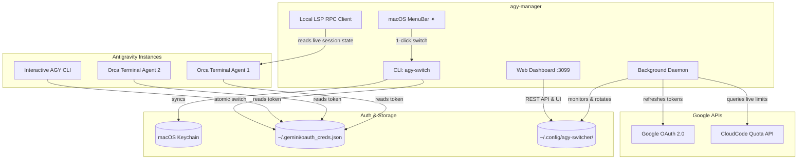

# Antigravity Multi-License Orchestrator ✦

[](LICENSE)
[](https://www.python.org/downloads/)
[]()

Production-grade multi-account license manager and automated quota orchestrator for **Google Antigravity (AGY)**.

Seamlessly pool, monitor, and auto-rotate between multiple **Google AI Pro** licenses in real-time — ensuring your AI agents, coding sessions, and terminal workers never stall when hitting 5-hour or 7-day quota thresholds.

---

## 🚀 Key Features

* **🔄 Zero-Downtime Auto-Rotation:** Automatically detects quota exhaustion (5-hour burst limits or 7-day individual caps) and rotates `active` credentials to the best available Google AI Pro account.
* **🌐 Modern Web Dashboard (`http://127.0.0.1:3099`):** Real-time monitoring hub with visual quota meters, live reset countdowns, token usage charts, 1-click profile switching, and web-based Google OAuth login.
* **⚡ Native macOS MenuBar App (`✦ AGY`):** Lightweight status bar widget displaying active license health and enabling instant 1-click account switching.
* **🧠 Deep Connect RPC Inspection:** Directly queries running Antigravity Language Server instances (`/exa.language_server_pb.LanguageServerService`) to inspect real-time token decrements and precise reset timestamps.
* **🔒 Zero Logouts & Atomic Token Refresh:** Background daemon keeps all registered accounts active and refreshed via Google OAuth APIs, syncing tokens directly to macOS Keychain and `~/.gemini/oauth_creds.json`.
* **🛡️ Tier Segregation & Smart Scoring:** Automatically prioritizes Pro subscriptions in rotation pools while preserving Starter/Free accounts for manual testing.

---

## 🏗️ Architecture



---

## 📦 Quickstart & Installation

### 1. One-line installer (macOS & Linux)

```bash
git clone https://github.com/mkmlabs-ai/antigravity-license-manager.git ~/.local/share/agy-manager
cd ~/.local/share/agy-manager
bash install.sh
```

The installer will:
1. Link `agy-switch` and `agy-hub` to `~/.local/bin/`.
2. Compile and launch the native macOS MenuBar app.
3. Register background launchd daemons (`com.mkm.agy-license-daemon` & `com.mkm.agy-web-dashboard`).
4. Auto-import any existing Antigravity logins from Keychain.

---

## 💻 CLI Usage (`agy-switch`)

```bash
# Interactive selection menu
agy-switch

# Auto-switch to the best Pro account with highest remaining quota
agy-switch auto
agy-switch best

# Switch directly to a specific account
agy-switch rodziewiczmic
agy-switch myaccount@gmail.com

# List all registered accounts, tiers, and live quota
agy-switch list

# Add a new Google account via browser OAuth
agy-switch add

# Force a token refresh and live quota sync from Google
agy-switch refresh

# Launch Web Dashboard
agy-hub
```

---

## 🌐 Web Dashboard (`:3099`)

Launch the web dashboard at any time with:

```bash
agy-hub
# Or open http://127.0.0.1:3099 in your browser
```

### Dashboard Capabilities:
* **Real-time Quota Meters:** Visual gauges for Gemini 5-hour rolling limits and 7-day subscription caps.
* **Instant Switching:** Click on any account card to switch system-wide credentials atomically.
* **One-Click Account Login:** Seamless browser OAuth authentication to connect additional Google accounts.
* **Token Consumption Telemetry:** Per-account historical token charts (Prompt, Completion, Thinking, Cache).

---

## ⚙️ Background Daemon & Services

The daemon operates silently in the background:
* **Every 60s:** Evaluates the active profile's remaining quota. If the active account hits a limit (`<= 5%` or 429), it automatically selects and activates the healthiest Pro account.
* **Every 15m:** Proactively refreshes OAuth tokens for all registered accounts to prevent session timeouts.

### Service Management (macOS):

```bash
# Restart background daemon
launchctl kickstart -k gui/$(id -u)/com.mkm.agy-license-daemon

# Restart web dashboard
launchctl kickstart -k gui/$(id -u)/com.mkm.agy-web-dashboard
```

---

## 🛡️ Security & Privacy

* **Local Storage:** All credentials and tokens are stored locally on your machine in `~/.config/agy-switcher/` and the native macOS Keychain with `0600` file permissions.
* **No Remote Telemetry:** No tokens or personal credentials are ever transmitted to third-party servers.
* **Safe Public Repo:** `.gitignore` is strictly configured to prevent accidental leakage of sensitive files or SQLite history databases.

---

## 📄 License

MIT License — Copyright (c) 2026 MKM Labs AI.
